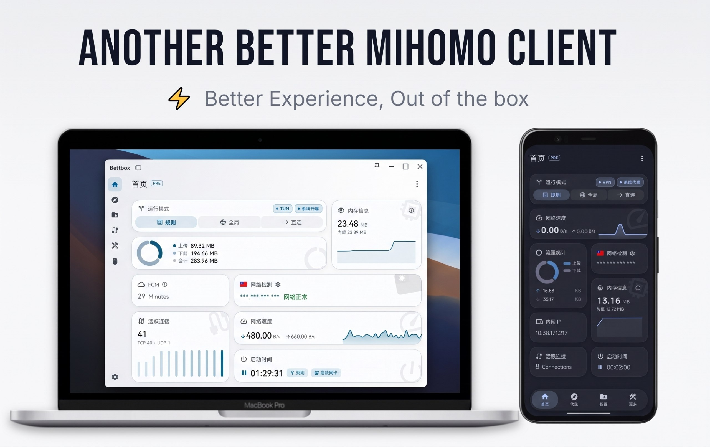

<h4 align="right">
  <a href="../README.md">简体中文</a> | <a href="README_en.md">English</a> | <a href="README_ru.md">Русский</a> | <a href="README_fa.md">فارسی</a> | <strong>日本語</strong> | <a href="README_ko.md">한국어</a>
</h4>

<h1 align="center">⚡ Cattbox</h1>
<p align="center">
  <strong>Another Better Network Toolbox</strong>
</p>

**Cattbox は、Mihomo コアをベースにしたマルチプラットフォーム対応のトラフィック分流・DNS デバッグツールです。究極のユーザー体験を追求し、長期安定稼働のために設計され、軽量で省リソース、データ収集は一切行いません。**

本プロジェクトは [Bettbox](https://github.com/appshubcc/Bettbox) の fork です。上流の宣伝内容是削除済み。違いは下記を参照。

[](https://github.com/AirportR/Cattbox/releases/latest) [](https://github.com/MetaCubeX/mihomo/releases/latest)

<p align="center">
  
</p>

## 🔀 この fork 独自の機能

* リモート URL 設定ごとに User-Agent を個別指定できます。
* Mihomo がまだ対応していないプロトコルにも対応（x365、Miu、Ninja）。


---
## 🚀 主な特徴

* **すぐに使える**：権限ガイド、TUN、マネージド分流モードをあらかじめ搭載。インストール後すぐに使えます。
* **軽量・軽快**：モバイルは低消費電力、デスクトップはバックグラウンド使用量が少なく、UI アニメーションも滑らかです。
* **高セキュリティ**：コアは Mihomo メインラインに追従し、各プラットフォームで必要最小限の権限のみを要求します。
* **堅牢な耐障害性**：マルチプラットフォームの極端なネットワーク環境における境界問題を最適化し、設定の二重検証により長期運用に適しています。
* **アーキテクチャ最適化**：デスクトップ版は ARM64 をネイティブサポートし、旧型デバイス向けの Compatible 版も継続してメンテナンスしています。
* **スマートデーモン**：マルチプラットフォームでのスマートな自動起動/停止、モバイルの Doze スリープへの対応、デスクトップ各プラットフォームでのトレイからのクイック操作に対応。
* **ビジュアル設定**：パラメータをビジュアルに調整でき、変更は即時反映。初心者でも設定ファイルを手動で書き換える必要はありません。
* **ホームウィジェット**：洗練された複数の内蔵ウィジェットで、ホームから全体の稼働状況を把握できます。
* **万能ツールボックス**：プロ仕様のネットワーク・DNS 分流デバッグツールを内蔵し、ネットワークの状態が一目で分かります。
* **自由なカスタマイズ**：Material Design 風の多彩なカラーテーマ、アイコンやタイトルのカスタマイズ、さらに 30 種類のスピードテストアニメーション。
* **エコシステムと拡張**：外部 JS オーバーライドスクリプトを GUI に対応させ、高性能な Code-forge エディタを搭載。
* **プライバシーリスクゼロ**：コードはオープンソースで広告なし。CI/CD は完全自動で公開監査が可能、バックグラウンドでのデータ収集はありません。

---
## 🛠️ インストールとダウンロード

**[[Releases]](https://github.com/AirportR/Cattbox/releases)** ページから、お使いのプラットフォームやシステムに適した最新のインストールパッケージをダウンロードしてください：

* **デスクトップ対応**: 
  * **Windows 8.1+:** (x64 / arm64)
  * **Linux Kernel 5.4+:** (x64 / arm64)
  * **macOS 12.0+:** (Intel / Apple Silicon)
* **モバイルおよびその他**: 
  * **Android 8.0+:** (ARMv8 / ARMv7 / x86_64 / Universal) 
  * **Android TV:** 大画面に完全対応、ARMv7 32ビット版も選択可能
  * **HarmonyOS NEXT:** [[卓易通]](https://harmonyos.cool/android-app) と組み合わせて安定して利用可能


---
## 💡 よくある質問

1. **動作環境と互換バージョン**：
   - Android 端末をご利用の場合、バックグラウンド実行権限が十分に付与されているかご確認ください。システム要件は Android 8.0 以上です。
   - デスクトップの旧型ハードウェアでは、CPU 命令セットアーキテクチャに応じて対応する Compatible 互換バージョンを選択してください。
   - セキュリティ：Cattbox はオープンソースで透明性が高く、データを収集しません。

2. **デスクトップの権限と TUN**：
   - Windows 版の管理者権限はインストーラー側で事前処理されているため、日常的な使用で手動の再認証は不要です。
   - macOS / Linux で TUN 仮想 NIC を有効にする際は、システムプロンプトに従って正しいシステムパスワードを入力し、認証を完了してください。
   - その他のエラーが発生した場合は、バックグラウンドで他のプロキシツールがポートを占有していないか確認し、Debug ログを添付してフィードバックを送信してください。

3. **macOS 初回インストールガイド**：
   - お使いの環境 (Intel / Apple Silicon) に応じた `.dmg` インストーラーをダウンロードして開き、Cattbox アイコンを Applications フォルダにドラッグしてください。
   - **システムセキュリティブロックの回避**（[現在 Apple 商業開発者証明書は未購入です](https://support.apple.com/en-us/102445)）：
     - **推奨**：「Finder - アプリケーション」で、**Cattbox アイコンを右クリックして「開く」を選択**し、確認ダイアログで「開く」をクリックしてください。
     - **代替案**：ブロックされた場合、システムの「設定 -> プライバシーとセキュリティ」から Cattbox を探し、「このまま開く」をクリックしてください。
   - 初めて TUN モードを有効にする際、システムパスワードの認証が求められます。パスワードを入力して仮想ネットワークインターフェースの作成を許可してください。

4. **サブスクリプションのインポートとトラブルシューティング**：
   - インポートに失敗した場合は、プロバイダーの管理パネルでサブスクリプションリンクをリセットしてから再度お試しください。
   - 異常が続く場合は、プロバイダーとノード形式を確認してください。クライアント側の不具合と確認された場合は、お気軽に Issue を提出してください。

---
## 💻 開発・ビルドと UI 適応

Windows プラットフォームでのビルド例：

* システム要件：Windows 10 以上
* 必要環境：Git, Visual Studio, Flutter 3.47.x, Golang, Inno Setup, Rust
```bash
* flutter pub get (依存関係の取得)
* dart .\setup.dart windows --arch amd64 --out core (Core コアのみビルド)
* dart .\setup.dart windows --arch amd64 --out app --compatible (任意の互換バージョン)
* ビルド完了後、生成物は `dist/` ディレクトリに出力されます
```

カスタムスクリプトの UI 適応：

* Cattbox は、外部オーバーライドスクリプトのグラフィカル UI 適応に対応しています。AIsouler 氏の **[スクリプト/設定共有](https://github.com/AIsouler/MyClash)** を例にすると、スクリプトの先頭行に以下の宣言を追加するだけで、内蔵のビジュアルスイッチと直接連動させることができます：
* <code>const Compatible_With_Bettbox = { ruleOptionsEnable: true };</code>
* スクリプト内のスイッチにポリシーグループなどが含まれる場合、`policyGroupOptions` でポリシーグループのスイッチ名を宣言できます。宣言されていないスイッチは「⚙️ その他の設定」サブメニューに自動分類されます：

```js
const Compatible_With_Bettbox = {
  ruleOptionsEnable: true,
  // ポリシーグループに属するスイッチ名を宣言（ruleOptionsEnable のキーと完全一致させる必要があります）
  policyGroupOptions: ['🚀 节点选择', '🛑 广告拦截'],
};
```
* `policyGroupOptions` が宣言されていない、または名称が一致しない場合、すべてのスイッチはフラットに表示されます。

---
## ❤️ 謝辞

<table>
  <tr>
    <td>
      
    </td>
    <td>
    Free code signing on Windows provided by <a href="https://signpath.io">SignPath.io</a>, certificate by <a href="https://signpath.org/">SignPath Foundation</a>
    </td>
  </tr>
</table>

* **[FlClash GUI](https://github.com/chen08209/FlClash)**（本プロジェクトは優れたオープンソースプロジェクト FlClash を起源としています。原作者の先駆的な探求と貢献に心から敬意を表します）
* **[Mihomo Core](https://github.com/MetaCubeX/mihomo)**（強力で柔軟なコアエンジン）

本プロジェクトの発展に貢献してくださったすべての [コントリビューター](https://github.com/AirportR/Cattbox/graphs/contributors)、そしてインスピレーションと参考元となった以下のオープンソースプロジェクトに感謝いたします：

[Zashboard](https://github.com/Zephyruso/zashboard), [CMFA](https://github.com/MetaCubeX/ClashMetaForAndroid), [Sparkle](https://github.com/xishang0128/sparkle), [SFA](https://github.com/SagerNet/sing-box-for-android), [HUSI](https://github.com/xchacha20-poly1305/husi), [V2rayN](https://github.com/2dust/v2rayN), [Bett-rules](https://github.com/appshubcc/bett-rules)

---
## 📄 オープンソースライセンス

本プロジェクトは [GPL-3.0 License](../LICENSE) のもとで公開されています。
