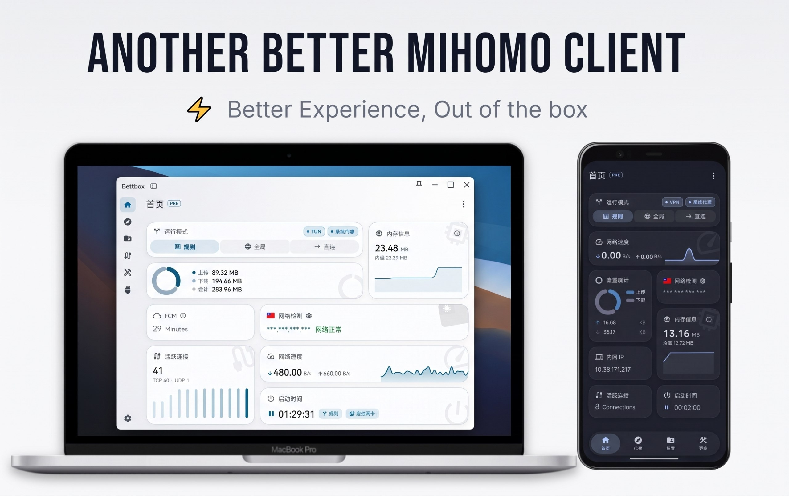

<h4 align="right">
  <a href="../README.md">简体中文</a> | <a href="README_en.md">English</a> | <strong>Русский</strong> | <a href="README_fa.md">فارسی</a> | <a href="README_ja.md">日本語</a> | <a href="README_ko.md">한국어</a>
</h4>

<h1 align="center">⚡ Cattbox</h1>
<p align="center">
  <strong>Another Better Network Toolbox</strong>
</p>

**Cattbox — это кроссплатформенный инструмент для маршрутизации сетевого трафика и отладки DNS на базе ядра Mihomo. Главный акцент — на превосходном пользовательском опыте: приложение создано для долгой стабильной работы, лёгкое, экономное к ресурсам и не собирает никаких данных.**

Это форк [Bettbox](https://github.com/appshubcc/Bettbox): рекламные материалы апстрима удалены. Отличия перечислены ниже.

[](https://github.com/AirportR/Cattbox/releases/latest) [](https://github.com/MetaCubeX/mihomo/releases/latest)

<p align="center">
  
</p>

## 🔀 Особенности форка

* Для удалённых URL-профилей можно задать собственный User-Agent.
* Поддержка дополнительных протоколов, которых пока нет в Mihomo (x365, Miu, Ninja).


---
## 🚀 Основные особенности

* **Готово к работе**: Подсказки по разрешениям, TUN и управляемый режим маршрутизации предустановлены — готово к использованию сразу после установки.
* **Лёгкость и плавность**: Низкое энергопотребление на мобильных устройствах, малая фоновая нагрузка на ПК и плавные анимации интерфейса.
* **Безопасность и доверие**: Ядро следует основной ветке Mihomo, на каждой платформе запрашиваются только минимально необходимые разрешения.
* **Отказоустойчивость и стабильность**: Оптимизированы граничные сценарии в экстремальных сетевых условиях на разных платформах; двойная проверка конфигурации подходит для длительной работы.
* **Архитектурная оптимизация**: Нативная поддержка ARM64 на ПК и постоянная поддержка совместимой (Compatible) версии для старых устройств.
* **Умный демон**: Умный автозапуск и остановка на разных платформах, адаптация к режиму сна Doze на мобильных устройствах и быстрое управление из системного трея на ПК.
* **Визуальные настройки**: Визуальная настройка параметров с мгновенным применением — даже новичкам не нужно вручную править конфигурацию.
* **Виджеты на главном экране**: Несколько продуманных встроенных виджетов позволяют следить за общим состоянием работы прямо с главного экрана.
* **Универсальный инструментарий**: Встроенные профессиональные инструменты отладки сети и DNS-маршрутизации — состояние сети видно с первого взгляда.
* **Персонализация**: Цветовые темы в стиле Material Design, настраиваемые значки и заголовки, а также 30 анимаций теста скорости.
* **Экосистема и расширения**: Внешние JS-скрипты переопределения получают графический интерфейс; встроен высокопроизводительный редактор Code-forge.
* **Нулевой риск приватности**: Открытый исходный код, без рекламы, полностью автоматизированный и публично проверяемый CI/CD, никакого сбора данных в фоне.

---
## 🛠️ Установка и загрузка

Перейдите на страницу **[[Releases]](https://github.com/AirportR/Cattbox/releases)**, чтобы скачать актуальный установочный пакет для вашей платформы и системы:

* **Поддержка настольных ПК**: 
  * **Windows 8.1+:** (x64 / arm64)
  * **Linux Kernel 5.4+:** (x64 / arm64)
  * **macOS 12.0+:** (Intel / Apple Silicon)
* **Мобильные устройства и другие**: 
  * **Android 8.0+:** (ARMv8 / ARMv7 / x86_64 / Universal) 
  * **Android TV:** Полная адаптация под большие экраны, доступна 32-битная версия ARMv7
  * **HarmonyOS NEXT:** Стабильно работает в связке с [[ZhuoYiTong]](https://harmonyos.cool/android-app)


---
## 💡 Часто задаваемые вопросы

1. **Системные требования и совместимость**:
   - На устройствах Android убедитесь, что приложению предоставлены достаточные разрешения для работы в фоновом режиме; система должна быть не ниже Android 8.0+.
   - Для старых ПК выбирайте соответствующую версию Compatible в зависимости от набора инструкций процессора.
   - Безопасность: Cattbox — проект с открытым исходным кодом, прозрачный и не собирающий данные.

2. **Права администратора на ПК и режим TUN**:
   - В установщике Windows права администратора преднастроены заранее — в повседневном использовании повторная авторизация вручную не требуется.
   - При включении виртуального адаптера TUN на macOS / Linux введите правильный системный пароль по запросу для подтверждения прав.
   - При возникновении других ошибок убедитесь, что порты не заняты другими прокси-программами, и приложите логи Debug при отправке отзыва.

3. **Руководство по первой установке на macOS**:
   - Скачайте пакет `.dmg` в соответствии с вашей платформой (Intel / Apple Silicon), откройте его и перетащите значок Cattbox в папку Программы (Applications).
   - **Обход системной защиты Gatekeeper** ([сертификат Apple Developer в настоящее время не приобретён](https://support.apple.com/en-us/102445)):
     - **Рекомендуется**: В папке «Программы» **нажмите правой кнопкой мыши на значок Cattbox и выберите «Открыть»**, затем подтвердите нажатием «Открыть» в системном диалоговом окне.
     - **Альтернатива**: Если запуск заблокирован, откройте «Системные настройки -> Конфиденциальность и безопасность», найдите Cattbox и нажмите «Подтвердить вход».
   - При первом включении режима TUN система запросит пароль; введите его, чтобы разрешить создание виртуального сетевого интерфейса.

4. **Импорт подписок и устранение неполадок**:
   - Если импорт не удался, сначала сбросьте ссылку на подписку в личном кабинете провайдера и повторите попытку.
   - Если проблема не устранена, сверьте формат узлов с поставщиком услуг; если подтвердится ошибка клиента, создайте Issue на GitHub.

---
## 💻 Разработка, сборка и адаптация UI

Пример сборки для платформы Windows:

* Системные требования: Windows 10 или новее
* Зависимости: Git, Visual Studio, Flutter 3.47.x, Golang, Inno Setup, Rust
```bash
* flutter pub get (получение зависимостей)
* dart .\setup.dart windows --arch amd64 --out core (сборка только ядра Core)
* dart .\setup.dart windows --arch amd64 --out app --compatible (опциональная сборка Compatible)
* После завершения сборки готовые файлы будут находиться в папке `dist/`
```

Адаптация пользовательских скриптов под графический интерфейс:

* Cattbox поддерживает визуальную адаптацию UI для внешних скриптов переопределения (override). Например, для **[скрипта/конфигурации](https://github.com/AIsouler/MyClash)** от AIsouler достаточно добавить в первую строку скрипта следующее объявление для прямой связи со встроенными переключателями:
* <code>const Compatible_With_Bettbox = { ruleOptionsEnable: true };</code>
* Если переключатели скрипта содержат группы политик и другие функции, имена переключателей групп политик можно объявить через `policyGroupOptions`; необъявленные переключатели будут автоматически помещены в подменю «⚙️ Другие настройки»:

```js
const Compatible_With_Bettbox = {
  ruleOptionsEnable: true,
  // Объявление имен переключателей групп политик; должны точно совпадать с ключами в ruleOptionsEnable
  policyGroupOptions: ['🚀 节点选择', '🛑 广告拦截'],
};
```
* Если `policyGroupOptions` не объявлен или имена не совпадают, все переключатели будут отображаться на одном уровне.

---
## ❤️ Благодарности

<table>
  <tr>
    <td>
      
    </td>
    <td>
    Free code signing on Windows provided by <a href="https://signpath.io">SignPath.io</a>, certificate by <a href="https://signpath.org/">SignPath Foundation</a>
    </td>
  </tr>
</table>

* **[FlClash GUI](https://github.com/chen08209/FlClash)** (Проект берет свое начало от превосходного открытого проекта FlClash; отдаем дань уважения новаторским исследованиям и вкладу автора)
* **[Mihomo Core](https://github.com/MetaCubeX/mihomo)** (Мощное и гибкое ядро)

Благодарим всех [Участников](https://github.com/AirportR/Cattbox/graphs/contributors), внесших вклад в проект, а также следующие открытые проекты за вдохновение и практические решения:

[Zashboard](https://github.com/Zephyruso/zashboard), [CMFA](https://github.com/MetaCubeX/ClashMetaForAndroid), [Sparkle](https://github.com/xishang0128/sparkle), [SFA](https://github.com/SagerNet/sing-box-for-android), [HUSI](https://github.com/xchacha20-poly1305/husi), [V2rayN](https://github.com/2dust/v2rayN), [Bett-rules](https://github.com/appshubcc/bett-rules)

---
## 📄 Лицензия

Этот проект распространяется под лицензией [GPL-3.0 License](../LICENSE).
